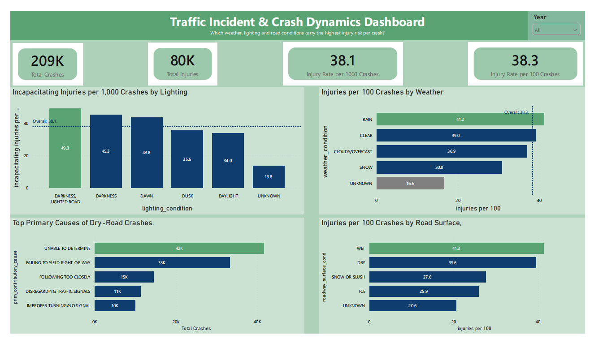

# Traffic Accident Analysis

Road-safety analytics project using MySQL and Power BI to examine which weather, lighting and road-surface conditions carry the highest injury risk per crash.

## Project Overview

This project analyses 209,275 cleaned traffic-crash records using SQL and Power BI.

The analysis is built around one road-safety question:

> Which weather, lighting and road-surface conditions carry the highest injury risk per crash, and where should an agency focus safety measures first?

Rather than relying only on raw injury counts, the project compares injury rates across conditions, because the number of crashes varies enormously by weather, lighting and road surface.

## Business Problem

A city transport agency wants to know which conditions are associated with more injuries and more serious crashes, so that road-safety measures can be targeted where they may have the greatest impact.

Counting injuries alone can be misleading, because most driving takes place in common conditions such as clear weather, daylight and dry roads. Those conditions dominate the totals even when each individual crash is no more dangerous.

The analysis therefore combines:

- Crash counts
- Injury counts
- Injury rates per 100 crashes
- Incapacitating-injury rates per 1,000 crashes
- Condition-level comparisons

## Dataset

- Dataset: Traffic_accidents Dataset
- Source: (https://www.kaggle.com/datasets/oktayrdeki/traffic-accidents)
- Original records: 209,306
- Final analytical records: 209,275
- Columns: 24
- Coverage: 2013–2025

Key fields include:

- Crash date
- Weather condition
- Lighting condition
- Road surface
- Crash type
- Primary contributory cause
- Total injuries
- Incapacitating injuries
- Fatalities

## Data Preparation

SQL was used as the primary analytical layer.

The preparation workflow included:

- Inspecting table structure and data quality
- Identifying and removing 31 duplicate records
- Reviewing unknown values in key categorical fields
- Preparing date fields
- Validating the cleaned analytical table

## Definitions

- **Injury rate:** total injuries divided by crashes, multiplied by 100. It counts injured people, so one crash can contribute more than one injury.
- **Incapacitating-injury rate:** incapacitating injuries divided by crashes, multiplied by 1,000.
- **Minimum size for ranking conditions:** when conditions are compared, only categories with at least 1,000 crashes are ranked, because rates from very small categories are unreliable.

## Business Questions

Main questions:

1. Which weather conditions carry the highest injury rate per 100 crashes?
2. Which lighting conditions carry the highest incapacitating-injury rate per 1,000 crashes?
3. How do injury rates differ by road surface?
4. How complete is the crash-cause data?

Supporting questions, based on raw counts:

5. Which weather condition has the most total injuries?
6. Which lighting condition has the most incapacitating injuries?
7. Which road surface has the most crashes, and what is the most common cause within it?
8. What is the most common first crash type?

## Key Findings

### Weather

Clear weather dominates the raw counts. It accounts for about 78.7% of crashes and 80.3% of injuries, simply because most crashes happen in clear weather.

Per crash, the picture is different:

- The overall rate is 38.3 injuries per 100 crashes.
- Clear weather is 39.0 per 100.
- Rain is the highest among conditions with at least 1,000 crashes, at 41.2 per 100. That is only about two more injuries per 100 crashes than in clear weather, so the gap is modest.
- Some smaller categories have higher rates (other 48.3, freezing rain or drizzle 46.1, sleet or hail 46.1, fog, smoke or haze 44.4), but each has fewer than 1,000 crashes, so their rates are less reliable.
- Snow (30.9 per 100) is lower than clear weather. In this data, severe-looking conditions do not mean more injuries per crash. The reason has not been tested.

### Lighting

Daylight has the most incapacitating injuries in absolute terms, because about 64% of crashes happen in daylight.

Per 1,000 crashes, low-light conditions carry more risk:

- Daylight: 34.0
- Dusk: 35.6
- Dawn: 43.8
- Darkness, not lighted: 45.3
- Darkness, lighted road: 49.3 (the highest, roughly 45% above daylight)
- Overall: 38.1

Darkness on a lighted road is slightly higher than darkness on an unlit road. The reason has not been tested. The Unknown lighting category (13.8 per 1,000) is small and likely reflects incomplete recording, so it is not interpreted.

### Road Surface

Dry roads recorded the most crashes. Differences in injury risk between surfaces are small:

- Dry: 39.6 injuries per 100 crashes and 40.5 incapacitating injuries per 1,000
- Wet: 41.3 per 100 and 37.7 per 1,000
- Snow or slush: 27.6 per 100 and 21.3 per 1,000
- Ice: 25.9 per 100 and 29.2 per 1,000

Wet roads have a slightly higher injury rate than dry roads but a lower incapacitating-injury rate. Snowy and icy surfaces show lower rates per crash; the reason has not been tested.

### Crash Cause

Within dry-road crashes, the most common primary cause was Unable to determine:

- 41,610 crashes
- 26.7% of dry-road crashes

This is a data-quality gap, because the largest cause category does not explain why the crashes occurred.

Categories recorded as Unknown (for weather, lighting and road surface) also show much lower injury rates than the rest of the data. This may reflect incomplete recording rather than safer conditions.

### Supporting Observations

- Turning was the most common first crash type: 64,150 crashes, 30.7% of all crashes.
- The most common crash type, No injury / drive away, peaked in October (11,136 crashes) and was lowest in April (8,463). Monthly comparisons need care, because month length and the number of years represented affect raw counts, and 2025 is a partial year.

## Recommendations

1. Prioritise low-light conditions, especially darkness on lighted roads, where the incapacitating-injury rate per crash is roughly 30% to 45% above daylight.
2. Treat rain as a secondary focus. Its injury rate is the highest among larger weather categories, but the gap over clear weather is small.
3. Improve crash-cause recording, because a large share of records have no determined cause, and check whether Unknown categories reflect missing injury data.
4. Investigate turning crashes, because Turning is the most common first crash type.

## Dashboard

The Power BI dashboard presents the analysed patterns through interactive visualisations covering:

- Weather
- Lighting
- Road surface
- Crash type
- Contributory cause
- Injury rates
- Monthly patterns

## Limitations

- This is observational data. The findings show associations, not causal relationships.
- Crash counts reflect how much driving takes place in each condition.
- The dataset contains no traffic-volume figures, so rates per vehicle or per mile cannot be calculated. The rates here are per crash.
- 2013 and 2025 are partial years, so monthly and annual comparisons may be affected.
- Unknown categories and categories with few crashes should be interpreted cautiously.
- Rates for categories below 1,000 crashes are shown for completeness but are not used for ranking.

## Tools

- MySQL
- MySQL Workbench
- SQL
- Power BI
- DAX

## Project Files

- `Traffic_Accident_data_cleaning.sql`: SQL data-cleaning script
- `Traffic_Accident_EDA.sql`: SQL exploratory data-analysis script
- `Traffic_Accidents_Dashboard.pbix`: Power BI report
- `Traffic_Dashboard.png`: dashboard screenshot
- `Traffic_Accident_Project_Documentation.docx`: project documentation
- `traffic_accidents`: Dataset

## Outcome

The project demonstrates an end-to-end road-safety analytics workflow:

SQL data cleaning → Exploratory analysis → Rate-based risk analysis → Power BI visualisation → Business recommendations

## Author

Sofeeyah Adekunle

Data Analyst
